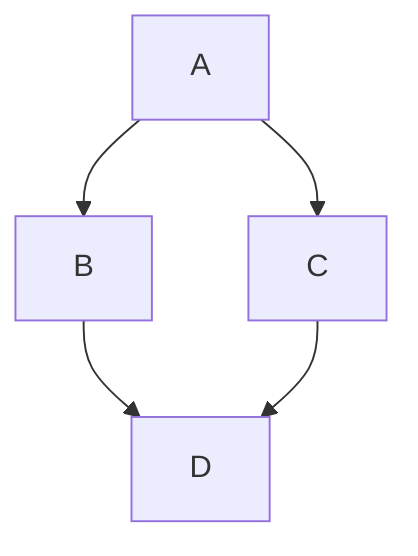
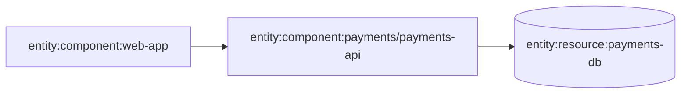

# backstage-plugin-techdocs-addon-mermaid

The `backstage-plugin-techdocs-addon-mermaid` allows rendering of [Mermaid](https://mermaid-js.github.io/) diagrams
within [Backstage TechDocs](https://backstage.io/docs/features/techdocs/techdocs-overview)

This plugin is a [Backstage TechDocs Addon](https://backstage.io/docs/features/techdocs/addons), which requires
Backstage v1.2+

## Getting started

1. Follow [the official documentation for TechDocs Addons](https://backstage.io/docs/features/techdocs/addons#installing-and-using-addons) to enable addons for techdocs.
2. For your backstage instance, make sure you have installed `mkdocs-techdocs-core` >= 1.0.2. Older versions will not render mermaid correctly!

    ```sh
    pip3 install mkdocs-techdocs-core==1.0.2
    ```

3. Install this plugin in your backstage app. Run the following command from the root of your backstage installation:

   ```sh
   yarn --cwd packages/app add backstage-plugin-techdocs-addon-mermaid
   ```

4. Enabling the Mermaid Addon:

   - **Legacy Frontend System**: Enable the addon within techdocs viewer's within `App.tsx` and `EntityPage.tsx`

   ```typescript jsx
   // packages/app/src/App.tsx
   // packages/app/src/components/catalog/EntityPage.tsx
   import { Mermaid } from "backstage-plugin-techdocs-addon-mermaid";

   // ...
   {techDocsPage}
   <TechDocsAddons>
     {/*...*/}
     <Mermaid />
   </TechDocsAddons>
   ```

   Diagrams follow the Backstage light/dark mode automatically. See [Mermaid Configuration](#mermaid-configuration) to customize them.

   - **New Frontend System**: Enable the addon module within `App.tsx`:

   ```typescript jsx
   // packages/app/src/App.tsx
   import techDocsPlugin from '@backstage/plugin-techdocs/alpha';
   import { techDocsMermaidAddonModule } from "backstage-plugin-techdocs-addon-mermaid";

   // ...

   const app = createApp({
     features: [
       // ...
       techDocsPlugin,
       techDocsMermaidAddonModule,
       // ...other techdocs addon modules
     ],
   });
   ```

## Use Mermaid in your TechDocs

~~~markdown
# Mermaid section

Here is a mermaid graph!



~~~

## Preview Docs Locally with `techdocs-cli`

`techdocs-cli serve` previews docs in a built-in Backstage app that doesn't include any addons, so diagrams show up as code blocks. Each release of this plugin comes with a preview app that includes the addon. Download it and pass it to `techdocs-cli` with `--preview-app-bundle-path`:

```sh
mkdir -p .techdocs-preview
curl -fsSL https://github.com/johanneswuerbach/backstage-plugin-techdocs-addon-mermaid/releases/latest/download/techdocs-preview-app.tar.gz | tar -xz -C .techdocs-preview
npx @techdocs/cli serve --preview-app-bundle-path .techdocs-preview
```

Replace `latest/download` with `download/v<version>` to pin a release. The preview app is a complete, self-contained app, so it works whichever Backstage version your own instance runs.

A few things to know:

- Diagrams use the addon's default configuration. Settings from your Backstage `app-config.yaml`, such as `lightConfig` or `enableZoom`, don't apply.
- Keep the preview on its default port (`--preview-app-port 3000`), which the preview app expects.
- Add `.techdocs-preview/` to your `.gitignore`.

## Mermaid Configuration

Without any configuration, diagrams follow the Backstage theme: they use Mermaid's `default` theme in light mode and its `dark` theme in dark mode.

The plugin supports customizing the Mermaid configuration for light and dark themes, as well as a shared base configuration. The available options are:

- `lightConfig` — Mermaid configuration applied when the Backstage theme is set to light mode.
- `darkConfig` — Mermaid configuration applied when the Backstage theme is set to dark mode. If it doesn't set a `theme`, Mermaid's `dark` theme is used.
- `config` — Shared configuration that is deep-merged on top of the selected theme configuration. Values here take precedence over `lightConfig`/`darkConfig`.

> **Note:** Setting `theme` in `config` applies that theme in both light and dark mode, which turns off the automatic switching. To keep diagrams in step with the Backstage theme, set `theme` in `lightConfig` and `darkConfig` instead, and keep shared settings such as fonts in `config`.

Each option follows this schema:

```typescript
interface MermaidConfig {
  // Theme for the diagram. Options: 'default' | 'base' | 'dark' | 'forest' | 'neutral' | 'null'
  theme?: string;
  // Custom theme variables to override the default theme colors, fonts, etc.
  themeVariables?: Record<string, any>;
  // Custom CSS to apply to the diagram
  themeCSS?: string;
  // Font family and size for the diagram
  fontFamily?: string;
  fontSize?: number;
  // ... any other Mermaid configuration options
}
```

See [Mermaid Config Schema](https://mermaid.ai/open-source/config/schema-docs/config.html) for all configuration options.

### Legacy Frontend System

Pass `lightConfig`, `darkConfig`, and `config` directly as props:

```typescript jsx
<Mermaid
  lightConfig={{ theme: "default", themeVariables: { primaryColor: "#bb2528" } }}
  darkConfig={{ theme: "dark", themeVariables: { primaryColor: "#bb2528" } }}
  config={{ fontFamily: "Arial", fontSize: 14 }}
/>
```

### New Frontend System

When using the new frontend system, these options are configured via `app-config.yaml`
under the `techdocs.addons.mermaid` key:

```yaml
# app-config.yaml
techdocs:
  addons:
    mermaid:
      lightConfig:
        theme: default
        themeVariables:
          primaryColor: "#bb2528"
      darkConfig:
        theme: dark
        themeVariables:
          primaryColor: "#bb2528"
      config:
        fontFamily: Arial
        fontSize: 14
```

No code changes are needed beyond the standard module registration shown in
the [Getting Started](#getting-started) section — the addon reads the
configuration automatically at runtime.

## Catalog Entities in Flowcharts (Experimental)

> **Experimental:** this is off by default, and its syntax and behavior may change in any release, including minor ones.

With `experimentalEntityNodes` turned on, you can label a flowchart node `entity:<entity ref>` to show a catalog entity. The addon replaces the label with the entity's title from the catalog and links the node to the entity's page:

~~~markdown

~~~

Refs use the catalog's standard format, `<kind>:[<namespace>/]<name>`. Like relations in `catalog-info.yaml`, a ref without a namespace uses the namespace of the entity whose docs you're reading. Clicking a node opens the entity's page within Backstage, without reloading the page. Titles come from the catalog's entity presentation API, which batches and caches lookups across diagrams. If the catalog doesn't answer within 3 seconds, the node shows the entity's name instead. Without this addon, for example in other markdown previews, the diagram still renders and shows the raw refs as labels.

To turn it on in the **legacy frontend system**, pass the prop:

```typescript jsx
<Mermaid experimentalEntityNodes />
```

In the **new frontend system**, set it in `app-config.yaml`:

```yaml
techdocs:
  addons:
    mermaid:
      experimentalEntityNodes: true
```

The [`techdocs-cli` preview app](#preview-docs-locally-with-techdocs-cli) has it turned on. It has no catalog, so entity nodes there show the entity's name.

## Zoom and Pan Functionality

The plugin supports interactive zoom and pan functionality for Mermaid diagrams. This allows users to:
- Zoom in/out using Ctrl/Cmd + mouse wheel
- Pan the diagram using Ctrl/Cmd + mouse drag

### Zoom Configuration Options

The zoom functionality can be configured using the following options:

```typescript
interface ZoomOptions {
  /**
   * Defines the minimum and maximum zoom scale limits.
   * Example: [0.1, 10] allows zooming out to 10% and in to 1000%
   * Default: [0.1, 10]
   */
  scaleExtent?: [number, number];

  /**
   * Defines the boundaries for panning the diagram.
   * Format: [[xmin, ymin], [xmax, ymax]]
   * Example: [[-1000, -1000], [1000, 1000]] limits panning to a 2000x2000 area
   * Default: No limits
   */
  translateExtent?: [[number, number], [number, number]];
}
```

### Legacy Frontend System

To enable zoom functionality, add the `enableZoom` prop and optionally configure the zoom behavior:

```typescript
<Mermaid
  enableZoom
  zoomOptions={{
    scaleExtent: [0.1, 10], // Optional: Set min/max zoom scale
    translateExtent: [[-1000, -1000], [1000, 1000]] // Optional: Set pan boundaries
  }}
/>
```

### New Frontend System

When using the new frontend system, zoom and pan are configured via `app-config.yaml`
under the `techdocs.addons.mermaid` key:

```yaml
# app-config.yaml
techdocs:
  addons:
    mermaid:
      enableZoom: true
      zoomOptions:
        scaleExtent: [0.1, 10]           # Optional: min/max zoom scale
        translateExtent:                   # Optional: pan boundaries
          - [-1000, -1000]
          - [1000, 1000]
```

No code changes are needed beyond the standard module registration shown in
the [Getting Started](#getting-started) section — the addon reads the
configuration automatically at runtime.

## Icon Packs

Mermaid diagrams can reference icons from registered Iconify icon packs using the `icon` shape syntax, e.g. `icon "logos:github" "GitHub"`. Custom icon packs can be registered as follows:

### Legacy Frontend System

Pass `iconLoaders` directly as a prop, either with inline icons or an async loader:

```typescript jsx
<Mermaid
  iconLoaders={[
    { name: 'custom', icons: { prefix: 'custom', icons: { 'my-icon': { body: '<path d="M0 0" />' } } } },
    { name: 'logos', loader: () => import('@iconify-json/logos').then((m) => m.icons) },
  ]}
/>
```

### New Frontend System

When using the new frontend system, icon packs are configured via `app-config.yaml` under the `techdocs.addons.mermaid.iconPacks` key. Each entry needs a `name` (the prefix used to reference its icons in diagrams) and either:

- `icons` — an inline [Iconify JSON](https://iconify.design/docs/types/iconify-json.html) icon set, for small custom packs, or
- `package` — the name of a published `@iconify-json/*` package (optionally with a subpath). These are resolved against the [unpkg](https://unpkg.com) CDN. For other/custom/internal domains, `http(s)://` URLs are resolved directly. Either way, this is fetched as JSON at runtime, so the package does **not** need to be installed as a dependency of your Backstage app.

```yaml
# app-config.yaml
techdocs:
  addons:
    mermaid:
      iconPacks:
        - name: custom
          icons:
            prefix: custom
            icons:
              my-icon:
                body: '<path d="M0 0" />'
        - name: logos
          package: '@iconify-json/logos'
        - name: hosted
          package: 'https://example.com/icons/my-icons.json'
```

> **Note:** Because the `package` field is fetched from a public CDN at request time rather than pinned as a versioned dependency, its content isn't reviewed or locked the way an installed npm package would be. Prefer inline `icons` for anything sensitive, or a `package`/URL you control and trust.

## Auto-Detection vs. Manual Detection

By default, this plugin will autodetect diagrams based on the starting token of the code block. In some cases, however, this auto-detection is not sufficient, for example, because of an unrecognized
diagram type or the use of front matter. In these cases, you can force the use of mermaid on blocks by adding configuration like this to your `mkdocs.yaml` file:

```yaml
markdown_extensions:
  pymdownx.extra:
    pymdownx.superfences:
      custom_fences:
        - name: mermaid
          class: mermaid
          format: !!python/name:pymdownx.superfences.fence_code_format
```

## Supporting Additional Layout Renderers

By providing a mermaid layout renderer that conforms to the `LayoutLoaderDefinition`, such as the [ELK Renderer](https://www.npmjs.com/package/@mermaid-js/layout-elk),
this plugin will include this provided render on page load.

**Example Usage**

In your Backstage application root folder run:
```bash
yarn add @mermaid-js/layout-elk
```

Then within both `App.tsx` and `EntityPage.tsx` add the following:
```typescript
import elkLayouts from '@mermaid-js/layout-elk';
...
<Mermaid layoutLoaders={elkLayouts} config={{layout: 'elk'}} />
...
```

This will support both the legacy syntax and the modern syntax for defining which mermaid diagrams utilize the new layout renderer
Legacy
```bash
%%{init: {"flowchart": {"defaultRenderer": "elk"}} }%%
```
Modern
```bash
---
config:
  layout: elk
---
```

## Contributors Guide

This plugin can be developed in the context of an existing Backstage deployment or a [new local deployment](https://backstage.io/docs/getting-started/#1-create-your-backstage-app).

### Releasing to npm

The `publish.yml` workflow uses [npm trusted publishing](https://docs.npmjs.com/trusted-publishers/)
to authenticate with GitHub Actions OIDC, without an `NPM_TOKEN` secret.
Before the first automated release, a package maintainer must configure a GitHub Actions
trusted publisher in the npm package settings with:

- Organization or user: `johanneswuerbach`
- Repository: `backstage-plugin-techdocs-addon-mermaid`
- Workflow filename: `publish.yml`
- Environment name: leave empty
- Allow direct publishing with `npm publish`

Once trusted publishing is configured and verified, remove the old `NPM_TOKEN`
repository secret and revoke the token in npm.

To release, merge a version bump in `package.json`, tag that commit as `v<version>`
(for example, `v0.30.0`), and publish a GitHub release for that tag. Pushing a tag
alone or saving a draft release does not publish to npm. The workflow checks that
the tag matches the package version, runs type checks, builds, tests, and packs
with Yarn before publishing the tarball with npm. Node.js 24 supplies an npm CLI
that supports trusted publishing (npm 11.5.1 or later).

Regular releases use the npm `latest` dist-tag; GitHub prereleases use `next`.
Use a new package version for each release; npm versions cannot be overwritten.

### Setup for Deployment

1. Fork and clone this repo into the plugins folder of your Backstage codebase.
2. To have yarn link the local version of the addon instead of the version on npm.
   1. Change directories to the new `plugins/backstage-plugin-techdocs-addon-mermaid folder` and run `yarn link`.
   2. Go up to the main Backstage directory and run `yarn link backstage-plugin-techdocs-addon-mermaid`.
3. Run `yarn install` in the Backstage root.
4. Follow the earlier instructions to add the plugin to your TechDocs pages in your Backstage deployment such as `app.tsx`.

### Manual Testing

After making changes to the plugin and having unit tests pass, to do manual end-to-end testing, follow the instructions below.

#### Option #1 Techdocs CLI

The `preview-app` workspace is a TechDocs CLI preview app that uses the addon straight from `src/`. Build it and serve a docs folder with it, for example the sample docs:

```sh
yarn workspace techdocs-mermaid-preview-app build
cd sampledocs
npx @techdocs/cli serve --preview-app-bundle-path ../preview-app/dist
```

`yarn workspace techdocs-mermaid-preview-app test:e2e` runs the same smoke test as CI. See [preview-app/README.md](preview-app/README.md) for its requirements.

#### Option #2 Use a Remote Location

Register a component via URL like any other Backstage component and view that component's TechDocs.
For example, to use the SampleDocs component in this repo:

1. Generate a [GitHub personal access token](https://docs.github.com/en/authentication/keeping-your-account-and-data-secure/managing-your-personal-access-tokens) for *public repos*.
2. Add the [GitHub integration](https://backstage.io/docs/integrations/github/locations) to your `app-config.local.yaml`.
3. `yarn dev` in the root of your Backstage codebase.
4. To register the demo docs, browse to `http://localhost:3000/catalog-import`
5. Register the URL pointing to the SampleDocs/catalog-info.yaml, example: `https://github.com/johanneswuerbach/backstage-plugin-techdocs-addon-mermaid/blob/main/sampledocs/catalog-info.yaml`
6. To iterate:
   1. Create a branch for the addon.
   2. Change the contents of the sampledocs.
   3. Commit and push.
   4. Register the catalog-info.yaml for your branch instead (keep in mind any security changes required for your personal access token).
   5. Iterate changes to markdown and changes to the plugin.
